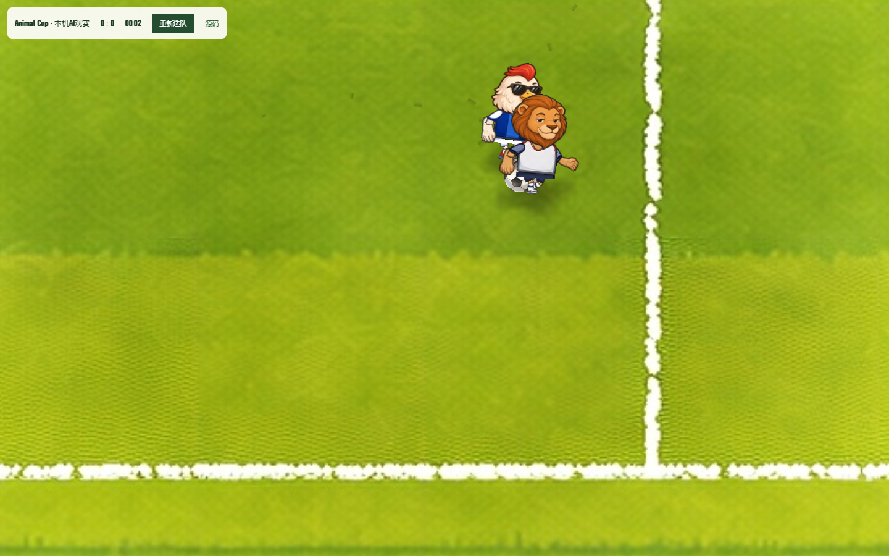

# Animal Cup · 动物足球模拟器

[直接观看本机比赛](https://yangwei251003.github.io/animal-world-cup/) · [Apache-2.0](LICENSE) · [原项目与完整说明](#-animal-cup--ai-动物足球模拟器)



## GitHub Pages体验范围

Pages版直接加载本项目现有Pixi比赛引擎、球员/球场素材和随机7人制阵型，选择两队后即可在浏览器观看AI对AI的本机模拟比赛。比分与计时读取真实比赛状态，不依赖云模型、账号、密钥、数据库或WebSocket服务器。

**静态版仅为单机观赛。** 原Next.js完整项目仍保留选队大厅、键盘/触屏控制、局域网与公网联机实现；这些额外入口没有被冒充成Pages已提供的服务。公网联机需自行部署Cloudflare Durable Objects或Node中继。

## 从源码体验

准备Node.js24 LTS与pnpm10，在仓库根目录执行：

```bash
pnpm install --frozen-lockfile
pnpm build:pages
```

`pages-dist`为静态成品；通过任意静态HTTP服务器打开（例如`python -m http.server 8080 --directory pages-dist`后访问`http://localhost:8080`）。不要直接双击HTML，比赛资源加载依赖HTTP。

需要完整Next.js应用时执行`pnpm dev`，浏览器打开`http://localhost:13000`。本轮将清理命令改为限定在项目生成目录内的跨平台脚本，Windows无需`rm -rf`。更多联机参数见下方原项目说明。

## 验证与变更

`pnpm check:pages`使用已安装的Playwright Chromium检查仓库子路径、真实比赛启动、计时推进和同源资源。首次可执行`pnpm exec playwright-core install chromium`安装测试浏览器。

本轮已在Chrome实际启动原比赛引擎、观察模拟时钟从约0.8秒推进到约2.8秒、检查画布、页面异常、早期运行错误、HTTP失败与外部请求。此结果覆盖静态单机体验，不代表所有球队组合、完整两分钟比赛、多人网络或所有设备都已验收。引擎旧版Pixi API有开发警告，不把警告隐藏成新的引擎升级。

2026-10-26：新增明确范围的静态观赛适配器与真实截图、修复比赛资源在GitHub仓库子路径下的加载、保留Apache-2.0和上游来源。后续可补静态版操控UI、更多比赛组合及触屏测试；当前不标为已完成。

## 本轮完整应用与依赖检查

在Node.js24/pnpm10的独立副本中，正常冻结安装已完成；同主版本修补Next15.5.28及相关网络/构建依赖后，直接执行`pnpm exec next build`通过（未以原构建包装器的宽松返回条件代替结果）。最终依赖审计为0项，Cloudflare工具和类型依赖也保持兼容范围。

本机以`ONLINE_HOST=127.0.0.1`、独立测试端口启动自有Node中继，现有验证脚本通过9组检查：缺失房间、双人加入、令牌重连、开赛与输入、二进制帧、重赛请求、控制屏/P1/P2、比赛中控制器重连、结束广播。只涉及本机临时房间，不代表公网或Cloudflare实际部署已验收。中继默认监听行为保留，可通过新增`ONLINE_HOST`限制接口。

`public/match-runtime-min`包含上游提供的预构建引擎及运行资源，是游戏必要的运行资产，随仓库保留；本仓库没有据此宣称拥有该引擎未提供的全部原始工程。联机/Worker部署及移动端实际触控仍需分别验收。

## 来源与原有完整项目说明

本仓库是[NeoXu954/animal-world-cup](https://github.com/NeoXu954/animal-world-cup)的Fork，原项目基于HappySeeds作品二次开发。第三方引擎、素材、字体和依赖继续适用各自来源及许可；没有将它们改称本人原创或重新覆盖为MIT。

<div align="center">

# 🐾 Animal Cup — AI 动物足球模拟器

**AI Animal Football Simulator**

从 8 支动物国家队中挑选你的队伍，排布阵型，观看或亲自操控 7v7 足球赛事，并通过局域网或公网与朋友对战。

Pick from 8 animal national teams, set your formation, watch or control a 7v7 match, and play with friends over LAN or the public internet.

[English](#english) · [中文](#中文)

</div>

---

<a name="中文"></a>

## 中文

> **项目来源**
> 本项目基于 [HappySeeds](https://happyseeds.ai/) 平台上的原创作品
> [Animal Cup](https://app-ce3abc4512.happyseeds.space/) Remix 后，
> 使用 **Claude Code** 进行二次开发并开源。

### 🎮 简介

Animal Cup 灵感来自经典街机足球游戏。你可以从 8 支动物国家队中选择队伍、设置阵型，观看 AI 模拟比赛，也可以使用键盘、触屏或手机手柄亲自操控。游戏支持本地单人、局域网手机手柄对战，以及两种邀请制公网联机模式。

### 🚀 技术栈

- **框架**：Next.js 15（App Router）+ React 19
- **比赛引擎**：预构建的 Pixi.js 运行时（`public/match-runtime-min/`）
- **部署**：Cloudflare Workers（通过 OpenNext）+ Durable Objects
- **多人对战**：局域网 WebSocket 中继 + 主机权威的公网房间与帧同步
- **国际化**：内置多语言支持（`app/i18n/`）

### 📂 项目结构

```text
app/
├── api/          # 后端 API 路由
├── data/         # 队伍、球员等游戏数据
├── i18n/         # 多语言文案
├── lan/          # 局域网对战页面
├── lobby/        # 大厅（选队、排阵型）
├── match/        # 比赛页面
├── online/       # 公网房间和客户端协议
├── online-pad/   # 公网手机手柄入口
├── pad/          # 手机手柄页面
├── ui/           # UI 组件
├── GameClient.jsx  # 游戏客户端入口
├── Landing.jsx     # 落地页
└── layout.jsx      # 全局布局
public/
└── match-runtime-min/   # 预构建的比赛引擎（Pixi 运行时）
cloudflare/       # Durable Object 公网房间服务
online/           # Node / Worker 共用的协议与数据校验
script/           # 构建、校验和本地中继脚本
```

### 🕹 快速开始

推荐使用 pnpm（仓库已附带 `pnpm-lock.yaml`）：

```bash
# 安装依赖
pnpm install

# 启动开发服务器（端口 13000）
pnpm dev
```

打开 `http://localhost:13000` 即可。

**局域网多人对战：**

```bash
pnpm dev:lan
```

比赛在共享大屏上运行，手机扫码后作为无线手柄接入。

**公网多人对战：**

```bash
pnpm dev:online
```

公网模式共用一套主机权威房间系统：

- **直接操控对战**：房主和对手分别在自己的浏览器中使用键盘或触屏操作。
- **在线手机手柄对战**：两边各使用一块比赛屏幕，并用各自手机扫码作为 P1 / P2 手柄。

创建者浏览器运行唯一的比赛模拟，对手屏幕接收约 30 FPS 的二进制比赛帧；公网服务只负责房间、鉴权、输入和帧中继。房间使用 6 位邀请码，并为房主、对手屏幕和 P1/P2 手柄分别保存恢复令牌。

本地开发时，Next.js 运行在 `13000`，公网房间中继运行在 `13002`。生产环境使用 Cloudflare Durable Objects，部署顺序如下：

```bash
# 1. 将 wrangler-online.toml 的 ALLOWED_ORIGINS 改为正式网页域名
# 2. 部署公网房间 Worker
pnpm deploy:online

# 3. 将返回的 Worker 地址写入 .env.local
cp .env.example .env.local
# NEXT_PUBLIC_ONLINE_SERVICE_URL=https://<your-worker>.workers.dev

# 4. 重新构建并部署网页
pnpm build
```

公网房间是邀请制休闲对战，目前不包含账号、自动匹配、排行榜或服务端防作弊。

### 🛠 常用脚本

| 命令 | 说明 |
| --- | --- |
| `pnpm dev` | 启动开发服务器（端口 13000） |
| `pnpm dev:lan` | 启动带局域网对战的开发服务器 |
| `pnpm lan` | 单独启动局域网中继服务 |
| `pnpm dev:online` | 启动网页和本地公网房间中继 |
| `pnpm online` | 单独启动本地公网房间中继 |
| `pnpm test:online` | 验证公网房间、输入和帧转发协议 |
| `pnpm test:online:browser` | 使用 Chrome 验证双屏、触控、手柄和画布渲染 |
| `pnpm deploy:online` | 部署 Cloudflare Durable Object 房间服务 |
| `pnpm build` | 生产构建 |
| `pnpm build:worker` | 构建 Cloudflare Workers 版本 |
| `pnpm start` | 运行生产构建 |

### 📄 许可证

本项目基于 [Apache License 2.0](./LICENSE) 开源。

---

<a name="english"></a>

## English

> **Origin**
> This project is derived from the original
> [Animal Cup](https://app-ce3abc4512.happyseeds.space/) on
> [HappySeeds](https://happyseeds.ai/), remixed and rebuilt with **Claude Code**.

### 🎮 Overview

Animal Cup is inspired by classic arcade football games. Pick from 8 animal
national teams, set your formation, watch an AI-simulated 7v7 match, or take
control with a keyboard, touchscreen, or phone gamepad. It supports local
single-player, LAN phone-controller matches, and two invite-only public online
modes.

### 🚀 Tech Stack

- **Framework**: Next.js 15 (App Router) + React 19
- **Match Engine**: Pre-built Pixi.js runtime (`public/match-runtime-min/`)
- **Deployment**: Cloudflare Workers (via OpenNext) + Durable Objects
- **Multiplayer**: LAN WebSocket relay + host-authoritative public rooms and frame sync
- **i18n**: Built-in multi-language support (`app/i18n/`)

### 📂 Project Structure

```text
app/
├── api/          # Backend API routes
├── data/         # Game data (teams, players, etc.)
├── i18n/         # Localized strings
├── lan/          # LAN multiplayer pages
├── lobby/        # Lobby (team select, formation setup)
├── match/        # Match page
├── online/       # Public room UI and client protocol
├── online-pad/   # Public phone-controller entry
├── pad/          # Phone gamepad page
├── ui/           # UI components
├── GameClient.jsx  # Game client entry
├── Landing.jsx     # Landing page
└── layout.jsx      # Global layout
public/
└── match-runtime-min/   # Pre-built match engine (Pixi runtime)
cloudflare/       # Durable Object public-room service
online/           # Protocol and validation shared by Node and Workers
script/           # Build, verification, and local relay scripts
```

### 🕹 Quick Start

pnpm is recommended (a `pnpm-lock.yaml` is shipped):

```bash
# Install dependencies
pnpm install

# Start the dev server (port 13000)
pnpm dev
```

Open `http://localhost:13000`.

**LAN multiplayer:**

```bash
pnpm dev:lan
```

The match runs on a shared big screen; phones scan a QR code to join as
wireless gamepads.

**Public online multiplayer:**

```bash
pnpm dev:online
```

Both public modes share one host-authoritative room service:

- **Direct controls**: the host and guest use keyboard or touch controls in their own browsers.
- **Online phone controllers**: each side has a match screen and pairs a phone as its P1 / P2 controller.

The creator's browser runs the only match simulation. The opponent screen
receives binary match frames at about 30 FPS, while the public service only
relays room state, authenticated input, and frames. Six-character room codes
are backed by separate recovery tokens for the host, opponent screen, and P1/P2
controllers.

Local development uses ports `13000` and `13002`. For production:

1. Set `ALLOWED_ORIGINS` in `wrangler-online.toml` to the deployed web origin.
2. Run `pnpm deploy:online` to deploy the Durable Object room service.
3. Put the returned Worker URL in `.env.local` as `NEXT_PUBLIC_ONLINE_SERVICE_URL`.
4. Run `pnpm build`, then deploy the web application.

Public rooms are intended for invite-only casual play. Accounts, automatic
matchmaking, rankings, and server-side anti-cheat are not included.

### 🛠 Scripts

| Command | Description |
| --- | --- |
| `pnpm dev` | Start the dev server (port 13000) |
| `pnpm dev:lan` | Dev server with LAN multiplayer |
| `pnpm lan` | Start the LAN relay server standalone |
| `pnpm dev:online` | Dev server with public online rooms |
| `pnpm online` | Start the local public-room relay |
| `pnpm test:online` | Verify room, input, and frame relay behavior |
| `pnpm test:online:browser` | Verify dual screens, touch, controllers, and canvas rendering in Chrome |
| `pnpm deploy:online` | Deploy the Durable Object room service |
| `pnpm build` | Production build |
| `pnpm build:worker` | Build for Cloudflare Workers |
| `pnpm start` | Run the production build |

### 📄 License

Released under the [Apache License 2.0](./LICENSE).
